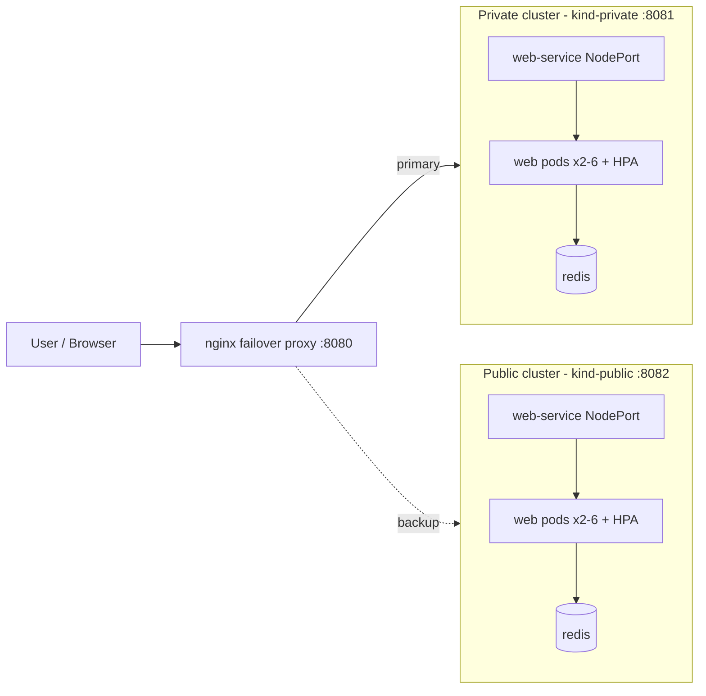

# Visitor Counter on Kubernetes (Hybrid Cloud + Cost Optimization)

Cloud Computing project: a Flask + Redis visitor counter, containerized with Docker,
deployed on Kubernetes (kind), autoscaled with an HPA, run on two clusters
(private + simulated public) with nginx failover, and cost-optimized with measured results.

## Architecture



Paste the mermaid block into https://mermaid.live (or draw it in draw.io) and export a PNG for submission.

## Repository layout

```
app/                  Flask app, Dockerfile (optimized), Dockerfile.before (baseline)
docker-compose.yml    Local run (web + redis)
k8s/                  Redis + web Deployments/Services, HPA
k8s-before/           Un-optimized web Deployment (cost baseline)
kind-private.yaml     Cluster config (host port 8081)
kind-public.yaml      Cluster config (host port 8082)
failover/             nginx proxy (primary private, backup public)
scripts/              Step-by-step demo scripts
cost-analysis.md      Before/after table
```

## Prerequisites

Docker, kubectl, kind, curl. Linux/macOS/WSL2. About 6 GB RAM free for two clusters.

## Task 1 - Containerize (Docker Compose)

```bash
docker compose up --build
# open http://localhost:5000 and refresh: the counter increases
docker compose down
```
Screenshot: browser showing the counter + `docker compose ps`.

## Task 2 - Kubernetes deployment + self-healing

```bash
./scripts/01-build.sh          # builds before/optimized images, prints sizes
./scripts/02-setup-clusters.sh # creates both clusters and deploys everything
kubectl --context kind-private get pods,svc
./scripts/03-selfheal.sh       # deletes a pod; a replacement is created
```
Web app: 2 replicas, requests 100m/64Mi, limits 250m/128Mi, readinessProbe `GET /healthz`
(returns 200 only when Redis responds). Redis: Deployment + ClusterIP Service.
Screenshots: `get pods` before/after deletion.

## Task 3 - Horizontal Pod Autoscaler (min 2, max 6, 50% CPU)

```bash
# terminal 1
kubectl --context kind-private get hpa -w
# terminal 2
./scripts/04-hpa-load.sh       # load for 5 min, then scale-down; saves hpa-log.txt
```
Record the replica timeline from `hpa-log.txt` (expected: 2 -> 4 -> 6 under load, back to 2 after ~5 min).
Screenshots: `get hpa -w` and `get pods` at peak.

## Task 4 - Hybrid cloud and failover

Both clusters run the same manifests (`kind-private`, `kind-public`; public is simulated).
The nginx proxy at `localhost:8080` sends traffic to the private cluster and falls back to the public one.

```bash
./scripts/05-failover.sh
```
The page shows `Cluster: private`; after `docker stop private-control-plane` it shows `Cluster: public`.

**Limitation:** each cluster has its own Redis, so the counter value is not shared after failover.
A production setup would use a shared/replicated managed Redis.

To use a real cloud cluster instead (GKE/AKS/EKS free tier), apply `k8s/` to it with a LoadBalancer
Service and point the nginx `backup` server at its external IP.

## Task 5 - Cost optimization

Techniques applied (details and measured table in `cost-analysis.md`):

1. **Image size reduction** - `python:3.12` single stage -> multi-stage `python:3.12-alpine`, non-root, no pip cache.
2. **Right-sizing** - requests 500m/512Mi -> 100m/64Mi, based on `kubectl top pods`.
3. **Autoscaling** - fixed 6 replicas -> HPA 2-6 (2 when idle).
4. **Redis memory cap** - `maxmemory 64mb` with LRU eviction.

```bash
./scripts/06-cost-measure.sh   # deploys BEFORE then AFTER, saves cost-measurements.txt
```

## Cleanup

```bash
./scripts/cleanup.sh
```

## Submission checklist

- [ ] Git repo link
- [ ] Architecture diagram (from the mermaid block)
- [ ] Screenshots: compose running, pods running, pod deletion, HPA scaling, failover, cost table
- [ ] `cost-analysis.md` filled with your measured values
